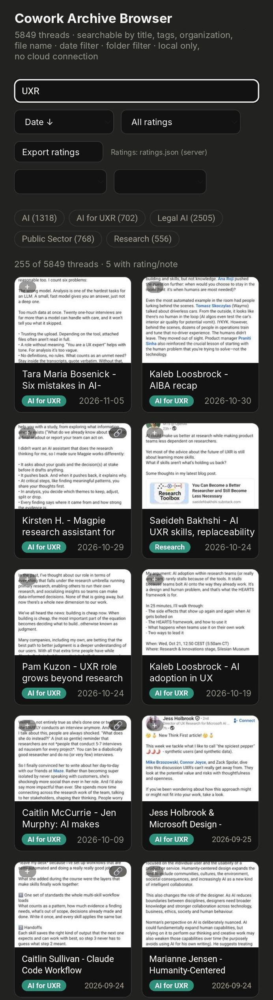
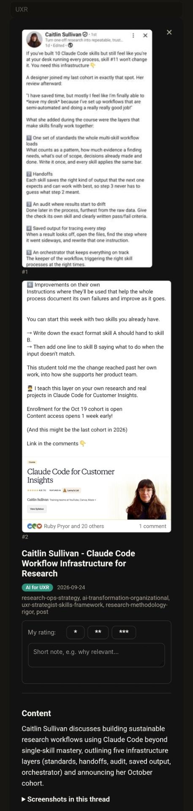

# Second Brain for an AI-for-UXR Screenshot Archive

A personal knowledge system, built and run with agentic AI in Claude Cowork, that turns **thousands of LinkedIn posts and discussion screenshots** about AI, AI for UX research, Legal AI, public sector and research into a searchable, browsable archive.

I built it because I follow the AI-for-UXR conversation closely and kept screenshots of the posts and threads that matter. Without structure, a screenshot is nearly impossible to find again. With it, every thread has an author, a topic, tags, a summary, readable links, and my own rating.

*The archive browser filtered by "UXR": thumbnails of the screenshots, thread titles, folder tags and dates. The browser itself is in German; interface text and titles in this image are translated into English.*

*Detail view of one thread: the screenshots in reading order, title, folder tag, date and tags, a rating with a short note, a summary of the content, and the readable links.*

> **The archive itself is not in this repository.** This repo shows the method, the skills, a small invented sample and the screenshot above.

## What it does

- Takes batches of 200-300 raw phone screenshots (by capture date)
- Groups them into **threads** (a post with its comments is one thread) and names them `Author - Topic - N`
- Sorts threads into 5 topic folders (AI, AI for UXR, Legal AI, Public Sector, Research) and writes a Markdown file per thread and an index per folder
- Extracts readable links from the images with OCR, and checks shortened links visually
- Detects duplicates and unusable screenshots
- Feeds a SQLite database and a single-file HTML **archive browser** (search, filters, thumbnails, ratings with notes, a "readable" toggle that enlarges screenshots)
- Runs with a documented handoff, so a new session can continue with the next batch

At the time of writing the archive holds about 5,800 threads.

## How the pipeline works

1. **Prepare** - copy the screenshots of a date range into a working folder; checksum them; write a batch manifest.
2. **Contact sheets** - build sheets of 6 numbered previews each, so a model can review 36 screenshots per image.
3. **First-pass review by cheap models** - several small-model subagents read the sheets in parallel and return one line per preview: author, topic, type, folder suggestion, links, continuation, possible defect.
4. **Targeted checks by the stronger model** - only where the first pass is unsure: duplicate and defect candidates, author badges, shortened-link codes, a sample of sheets.
5. **Mapping file** - a short Python file that declares each thread (author, topic, folder, type, tags, preview numbers, description). A completeness check makes sure every screenshot is assigned exactly once.
6. **Archive** - rename, move, create thumbnails, write thread and folder Markdown files.
7. **Links** - OCR scan, human-style verification, insertion into the thread files.
8. **Finalize** - update the database, the HTML browser data and the folder indexes; keep a backup of each stage.
9. **Document** - append to a processing log and update the handoff file.

## Design principles

- **Human decides.** Every batch starts only on my instruction. Nothing is deleted automatically; unusable files go to a review folder.
- **Cost-aware.** Routine image reading goes to small models; the stronger model handles the exceptions. Image content never passes through the main conversation.
- **Resumable.** Long steps (OCR, thumbnails) can be re-run and continue where they stopped.
- **Verifiable.** Dry runs before renames, completeness assertions, backups before each database write, syntax checks on generated HTML.
- **Rules live in files.** Naming and folder rules, tag vocabulary and edge cases are documented, so a fresh session behaves the same way.

## What is in this repo

| Path | Content |
|---|---|
| `skills/screenshot-rename/SKILL.md` | The naming and organisation skill (generalised) |
| `docs/pipeline.md` | Pipeline steps and lessons learned |
| `docs/taxonomy.md` | Folders, thread types, tag vocabulary |
| `server/archive_server.py` | Small local server for the browser: ratings and readable images |
| `sample/` | An invented example of thread files and a folder index |

## Lessons so far

- Small models are good at first-pass classification, but they misread some interface details (for example author badges, or a phone interface mistaken for a defect). A sample check by the stronger model pays off.
- OCR misreads characters in shortened links (l, I, 1, 5, S), so every shortened link is checked against the image.
- Contact sheets make a large batch tractable in a few model calls.
- Written rules and a handoff file matter more than any single prompt: they make a long-running, multi-session workflow consistent.

## Author

Pete von Savigny - senior UX researcher, Berlin. Contact: pvs@userresearch.de
